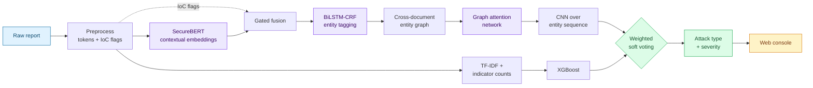
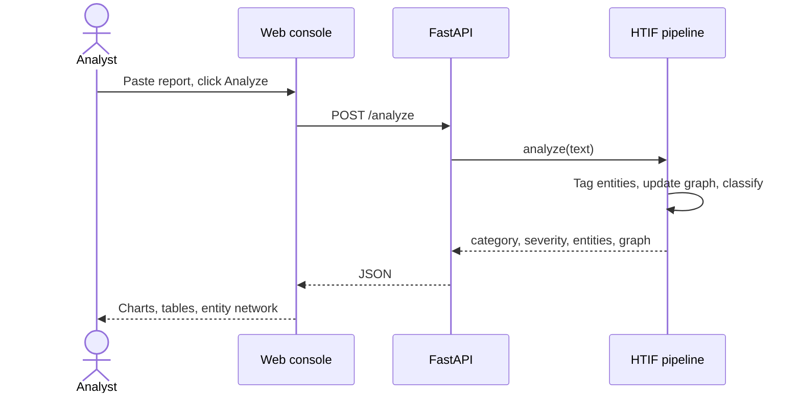
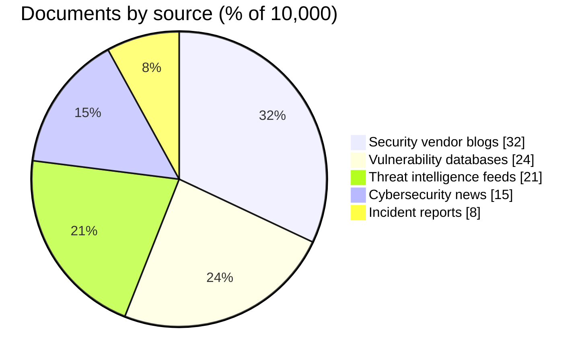

<div align="center">

# HTIF: Hybrid Threat Intelligence Fusion

**Turn unstructured threat reports into structured intelligence: entities, indicators, links and attack type.**


</div>

---

## Contents
[Overview](#overview) · [Architecture](#architecture) · [Web console](#web-console) · [Quick start](#quick-start) · [API](#api) · [Training data](#training-data) · [Reported results](#reported-results-from-the-paper) · [Project structure](#project-structure) · [Design notes](#design-notes) · [Roadmap](#roadmap) · [Status](#status)

## Overview

Security teams receive far more blogs, advisories and incident reports than analysts can read. HTIF reads a report and returns:

| Output | How it is produced |
|---|---|
| **Entities** (malware, actors, techniques, vulnerabilities, products, indicators) | SecureBERT + gated IoC fusion + BiLSTM-CRF |
| **Indicators of compromise** (IPs, hashes, URLs, domains, CVEs) | Regex flags fused into the model and listed directly |
| **Entity links across reports** | Cross-document graph + graph attention network |
| **Attack type** (phishing, ransomware, DDoS, vulnerability exploit, malware, other) | CNN + XGBoost, combined by weighted soft voting |
| **Severity score** (0 to 10) | Rule-based from class probabilities, indicator count and CVE presence |

## Architecture



Each stage keeps a different kind of information: **semantic** (transformer), **sequence** (BiLSTM-CRF), **relational** (graph attention) and **decision** (ensemble).

### Request flow



## Web console

The console at `http://localhost:8000` has four pages:

| Page | What it shows |
|---|---|
| **Dashboard** | Attack-type and severity donuts, severity trend, top entities, entity-type mix, entity network across reports |
| **Analyze report** | Severity gauge, probability bars, entity network, indicator and entity tables |
| **History** | Every analysis with CSV export (stored in your browser only) |
| **About** | Pipeline summary |

<!-- Add screenshots: save them in docs/ and uncomment.


-->

## Quick start

```bash
git clone https://github.com/tiwariAnkleshwar/HTIF-threat-intelligence.git
cd HTIF-threat-intelligence

python -m venv .venv
# Windows:      .venv\Scripts\activate
# macOS/Linux:  source .venv/bin/activate

pip install -r requirements.txt     # if torch-geometric fails, follow its install guide for your platform
```

Train on the bundled synthetic data (the first run downloads `ehsanaghaei/SecureBERT`), then start the server:

```bash
python -m htif.train --data data/labeled_synthetic.jsonl --epochs 3
uvicorn api:app --port 8000
```

Open <http://localhost:8000>. The first request loads the model and can take a minute or two on a CPU.

> The trained models are not in this repository (they are several hundred MB). `python -m htif.train` creates them in `artifacts/`.

## API

| Method | Path | Purpose |
|---|---|---|
| `GET` | `/health` | Server status |
| `POST` | `/analyze` | Analyze one report |
| `GET` | `/docs` | Interactive Swagger UI |

```bash
curl -X POST http://localhost:8000/analyze \
  -H "Content-Type: application/json" \
  -d '{"text": "LockBit operators exploited CVE-2023-4966 in Citrix and sent data to 185.220.101.4."}'
```

Response shape (values illustrative):

```json
{
  "category": "ransomware",
  "probabilities": {"ransomware": 0.71, "vuln_exploit": 0.18, "malware": 0.05, "phishing": 0.03, "ddos": 0.02, "other": 0.01},
  "severity": 7.4,
  "severity_level": "Critical",
  "entities": [{"text": "LockBit", "type": "MALWARE"}, {"text": "CVE-2023-4966", "type": "VULNERABILITY"}],
  "iocs": {"cve": ["CVE-2023-4966"], "ip": ["185.220.101.4"]},
  "graph": {"nodes": ["MALWARE|lockbit"], "edges": [["MALWARE|lockbit", "PRODUCT|citrix"]], "related": {}}
}
```

## Training data

One JSON object per line:

```json
{"id": "d1", "tokens": ["LockBit", "exploited", "CVE-2023-4966", "."], "tags": ["B-MALWARE", "O", "B-VULNERABILITY", "O"], "label": "ransomware"}
```

- `tags`: BIO tags, one per token, from `MALWARE, ACTOR, TECHNIQUE, VULNERABILITY, PRODUCT, IOC`.
- `label`: `phishing`, `ransomware`, `ddos`, `vuln_exploit`, `malware` or `other`.

| File | Contents |
|---|---|
| `data/labeled_synthetic.jsonl` | 240 template-generated documents, 40 per class, exact tags. For testing the pipeline, not for measuring accuracy. |
| `data/raw_sample.jsonl` | 12 unlabelled reports for the weak-labelling script |
| `data/labeled_sample.jsonl` | Their weak labels (gazetteer + regex) |

For real results, use gold-annotated data. Public cybersecurity NER corpora can supply tokens and tags (map their labels onto the six types above). Attack-type labels usually have to be added by hand or from feed metadata.

## Reported results from the paper

> These figures are transcribed from the paper that describes HTIF. **This repository does not reproduce them.** Reproducing them needs the paper's corpus and training setup.

### Threat classification


### Ablation study


Removing the graph attention network costs the most correlation accuracy (0.93 to 0.74), which the paper takes as evidence that the stages work best together.

### Paper corpus composition



## Project structure

```text
HTIF-threat-intelligence/
├── api.py                    FastAPI app (/analyze, /health, serves the console)
├── requirements.txt
├── static/
│   └── index.html            Web console (dashboard, analyzer, history)
├── htif/
│   ├── config.py             Labels, sizes, encoder name
│   ├── features.py           Tokenizer, IoC regex flags, BIO span decoding
│   ├── data.py               Dataset loading, encoding, batching
│   ├── model.py              GatedFusion, Tagger (BiLSTM-CRF), EntityGAT, EntityCNN
│   ├── graph.py              Cross-document entity graph
│   ├── classifier.py         Sparse features, XGBoost wrapper, voting weights
│   ├── train.py              Staged training and evaluation
│   └── pipeline.py           Inference: HTIF.analyze()
├── scripts/
│   └── bootstrap_labels.py   Weak labelling for smoke tests
├── data/                     Sample and synthetic datasets
└── docs/                     README charts
```

## Design notes

- **Staged training, not joint.** The paper describes joint optimisation. This code trains the tagger, then the graph attention network, then the CNN and XGBoost, which is simpler to debug.
- **Graph supervision.** Graph nodes take weak labels from the training documents they appear in. The graph includes validation and test documents without their labels (transductive).
- **Learned gate.** The fusion weight is a per-token learned gate, a small extension of the paper's single `alpha`.
- **Severity is a heuristic.** The paper gives no severity labels, so nothing is learned for it.
- **Inference graph.** Each request copies the stored graph to add the new document. This is fine for thousands of nodes; use an incremental or database-backed graph at larger scale.
- **Length.** Documents are cut at 256 sub-word tokens (about 150 to 200 words). Split long reports first.

## Roadmap

- [ ] Batch mode: analyze several pasted reports at once
- [ ] Gold-annotated training data and held-out evaluation
- [ ] Export to STIX 2.1
- [ ] Explainability for classifications
- [ ] SIEM integration and real-time alerts
- [ ] Multilingual embeddings

## Status

Research prototype. The code has been run end to end on the synthetic data, but it has not been validated on real threat reports, and the paper's reported scores are not reproduced here. Expect to adjust package versions (`torch-geometric`, `pytorch-crf`) on some platforms.
